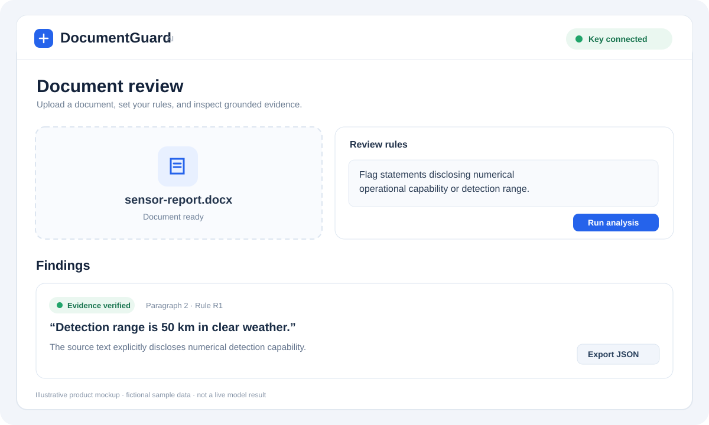
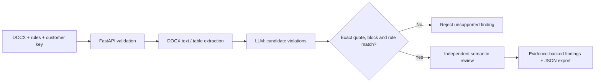

<div align="center">

# DocumentGuard AI

**Review Word documents against your own compliance rules, with source-grounded evidence.**

Upload a DOCX · Write rules in plain English · Inspect potential violations · Export findings

[](assets/sample.docx)
[](docs/PROMPTS.md)
[](docs/ARCHITECTURE.md)

</div>

## Product preview



## Try it in 60 seconds

| Step | What the reviewer does | What to expect |
|:---:|---|---|
| **01** | Run the application locally (instructions below), then select **Connect key** | Enter your **own** OpenAI API key in a hidden field. No shared or preloaded key. |
| **02** | [Download the sample DOCX](assets/sample.docx) and upload it | The app accepts text-based Word documents up to **5 MB**, including tables. |
| **03** | Enter a rule: `Flag statements disclosing numerical operational capability or detection range.` | Rules are interpreted semantically by the model, not matched with a fixed regex list. |
| **04** | Select **Run analysis** | See rule, exact quote, paragraph/table location, explanation and review status. |
| **05** | Inspect the evidence and **Export JSON** | Human review remains necessary for uncertain or high-stakes findings. |

> **Privacy / key handling:** The key is held in browser memory for the current page session, sent over HTTPS in the `Authorization` header to the FastAPI backend for the analysis request, and not stored by this app. The key is not included in multipart form data, URLs, or application responses. **Infrastructure can still log request headers if configured to do so**: disable or redact `Authorization` in reverse-proxy, hosting, tracing, error-reporting, and APM logs before using real keys. Refreshing or disconnecting clears it. Do **not** paste a key into GitHub issues, README files, screenshots or support tickets. Uploaded documents and request contents still pass through the hosting provider and OpenAI; confirm your organization's data policies before using sensitive documents.

## What the product does

| Capability | Included |
|---|---|
| Arbitrary natural-language rules | **Yes**, 1–15 English rules per review |
| DOCX paragraphs and tables | **Yes**, with block-level location |
| Evidence grounding | **Yes**, candidate quotes must exactly occur in the referenced source block |
| Independent semantic second pass | **Yes**, with confirmed / uncertain / rejected outcomes |
| Bring Your Own Key | **Yes**, no bundled API key and no persistent key storage |
| JSON export | **Yes** |
| OCR, images, text boxes and tracked-change interpretation | **Not comprehensively supported** |
| Deterministic guarantee of semantic correctness | **No** |

### How it works



**The model decides semantic relevance; code checks evidence provenance.** Exact-quote matching is deterministic, but semantic accuracy and completeness are not. The second LLM pass is another judgment, not a proof.

## Reviewer shortcuts

| I want to… | Open |
|---|---|
| **Preview the interface** | [Product mockup](assets/product-mockup.svg) |
| **Understand the prompts** | **[Actual detection and verification prompts](docs/PROMPTS.md)** |
| **See the architecture and security boundaries** | [Architecture](docs/ARCHITECTURE.md) |
| **Read design trade-offs** | [Engineering decisions](docs/ENGINEERING.md) |
| **Explore the product planning conversation** | [Product Planning Conversation](docs/Product_Planning_Conversation.md) |
| **Inspect test coverage and limitations** | [QA / E2E report](docs/TESTING.md) |
| **Review agent integration** | [Agent skill](skills/documentguard/SKILL.md) |
| **Check delivery readiness** | [Delivery status](docs/DELIVERY_STATUS.md) |

## Run locally

Requires Python 3.11+.

```bash
python -m venv .venv
source .venv/bin/activate  # Windows: .venv\Scripts\activate
pip install -r requirements.txt
uvicorn app.main:app --host 127.0.0.1 --port 8000
```

Open **http://127.0.0.1:8000** and connect your own key inside the UI. The web app does **not** need an `OPENAI_API_KEY` server environment variable.

### Run tests

```bash
pip install -r requirements-dev.txt
python -m playwright install chromium
pytest -q
```

Browser tests exercise real Chromium and the FastAPI route with a **mocked OpenAI response**. They validate the application workflow, not live model quality. See the [test report](docs/TESTING.md) for verified coverage and gaps.

## API at a glance

`POST /api/analyze` accepts multipart form fields `file` (DOCX, max 5 MB), `rules` (JSON array of 1–15 rules), and the `Authorization: Bearer <customer-key>` header (request-scoped). The response includes `violations`, `count`, `rejected_unverified`, `blocks_scanned` and `rules_scanned`. A finding contains `rule_id`, `block_id`, `location`, `quote`, `explanation` and `status`.

**Production note:** This is a stateless request flow, not a complete enterprise DLP/compliance platform. It does not include authentication, persistent audit trails, quotas, OCR or a calibrated live-provider precision/recall evaluation. Do not treat zero findings as proof of compliance.

<sub>DocumentGuard AI · Evidence first · Customer-owned keys · Transparent QA</sub>
