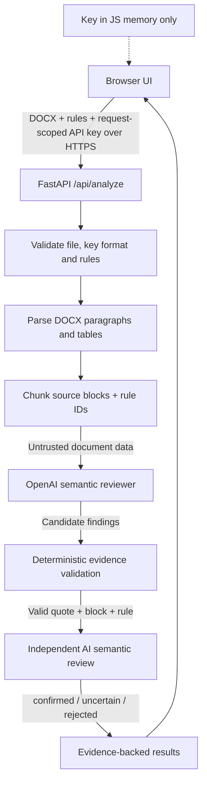

# DocumentGuard AI

**Evidence-first DOCX compliance review** · AI Engineer take-home assignment · Bring Your Own Key (BYOK)

Upload an English-language `.docx`, define arbitrary natural-language rules, and inspect source-grounded violations. DocumentGuard uses an AI model for semantic interpretation and deterministic source checks for provenance. It is **not** a deterministic guarantee of compliance.

**[Architecture](docs/ARCHITECTURE.md) · [QA report](docs/TESTING.md) · [Engineering decisions](docs/ENGINEERING.md) · [Agent skill](skills/documentguard/SKILL.md) · [Prompts](docs/PROMPTS.md)**

## Customer experience

1. Open the app, select **Connect key**, and enter your own OpenAI API key. The key is never shown again or stored persistently. Reconnecting first disconnects the old key; refreshing the page clears it.
2. Select a `.docx` (max **5 MB**) and enter **1–15 English rules**. Example: `Flag statements disclosing numerical operational capability or detection range.`
3. Run semantic review, inspect exact source quotations, paragraph/table location, associated rule, explanation, and status.
4. Export findings as JSON. Zero findings **does not prove compliance**. Findings marked `needs_human_review` require a reviewer.

No demo/heuristic mode is available. A key is needed for every analysis session. There is no built-in key and **no OpenAI environment variable required on Vercel**.

## Architecture



**Critical distinction:** Exact quote verification is deterministic; the model's interpretation of the rule remains probabilistic, including at temperature 0. The skeptical second pass is another model judgment, not a mathematical proof. See [architecture and security](docs/ARCHITECTURE.md).

## Start locally

Requires Python 3.11+.

```bash
python -m venv .venv
source .venv/bin/activate             # Windows: .venv\Scripts\activate
pip install -r requirements.txt
uvicorn app.main:app --host 127.0.0.1 --port 8000
```

Open **http://127.0.0.1:8000**. Connect your own OpenAI API key in the UI. **Never put your key into this repository or any GitHub issue.** For the optional agent skill CLI only, set the key in the shell environment securely.

## API

`POST /api/analyze` multipart form-data:

| Field | Type | Constraint |
|---|---|---|
| `file` | DOCX binary | 1–5 MB, DOCX ZIP validation |
| `rules` | JSON string array | 1–15 rules, 8–500 characters each |
| `api_key` | secret form field | OpenAI key supplied per request, not stored |

Success JSON contains `violations`, `count`, `rejected_unverified`, `blocks_scanned`, `rules_scanned`, and `engine`. Each violation includes `rule_id`, `rule`, `block_id`, `location`, `quote`, `explanation`, and `status` (`evidence_verified` or `needs_human_review`). Errors are sanitized before returning them to the browser.

## Run quality gates

```bash
pip install -r requirements-dev.txt
python -m playwright install chromium
pytest -q
```

The browser E2E test runs in Chromium, uses an intercepted AI response and exercises key connection, DOCX upload, rendering, JSON export and disconnect. API tests exercise actual FastAPI request parsing and BYOK behavior. Model-orchestration tests use mocked model responses. **No live OpenAI accuracy or billing test was executed**; see [QA report](docs/TESTING.md). A real customer trial needs an authorized key and approved non-sensitive sample document.

## Deploy to Vercel

Deploy this repo as a Python/FastAPI project, with the project root set to the repository root. `app/main.py` exposes `app`. Production must use HTTPS, and you should inspect runtime timeouts and resource limits. **Do not configure `OPENAI_API_KEY` on Vercel for the web app**; every customer supplies their own key through the UI. No customer key is bundled with code or committed to GitHub.

The app is stateless and does not persist uploaded documents, results, or keys. Nevertheless, request contents are processed by Vercel and OpenAI; consult your organization's data-processing and retention rules before uploading sensitive documents. This implementation is a single-user request flow; it does not provide authentication, quotas, DLP, audit history, or a documented retention agreement.

## Project structure

| Path | Purpose |
|---|---|
| `app/main.py` | Stateless HTTP boundary and sanitized errors |
| `app/core.py` | DOCX parser, rule normalization, model orchestration, evidence verification |
| `app/static/index.html` | Responsive UI, in-memory BYOK, client-side rendering and JSON export |
| `tests/` | Unit, HTTP integration, security and browser UI E2E |
| `.github/workflows/test.yml` | CI gates including Chromium and secret-pattern checks |
| `skills/documentguard/` | Agent skill and CLI integration |
| `docs/` | Architecture, design decisions, prompts, reproducible QA and limitations |

## Important limitations

- Text-based DOCX paragraphs and tables are supported; images, handwriting, text boxes, tracked-change semantics and headers/footers are not comprehensively extracted.
- Context is chunked into groups of 35 blocks; cross-chunk reasoning may be incomplete.
- Files with many blocks or findings can exceed serverless execution time or provider quota. No background-job queue is included.
- Zero findings is not proof of compliance; professional review remains essential for high-impact disclosures.
- A real-provider evaluation corpus is needed to estimate recall/precision, false positives and omissions.
